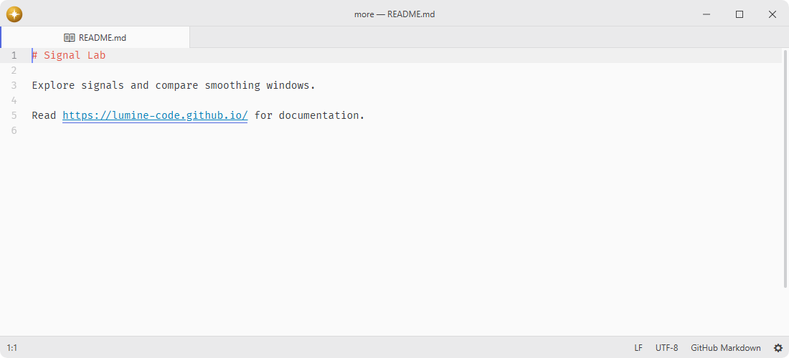

# link

Open web links in the browser and Markdown file links in the editor.

Fork of [pulsar-edit/pulsar](https://github.com/pulsar-edit/pulsar) (`packages/link`).

## Features

- **Open links**: open the http(s) link under the cursor without leaving the editor.
- **Markdown files**: open relative paths, absolute paths and file URLs in the editor.
- **Cursor aware**: detects the link at the current cursor position in any editor.
- **Context menu**: opens the link at the right-click position without moving the cursor.
- **Hyperclick**: provides complete link ranges and navigation actions to Hyperclick, including named Markdown references.

## Installation

To install `link` search for it in the Install pane of the Lumine settings, or run the command `lumine --install lumine-code/link`.

## Commands

Commands available in `lumine-text-editor:not([mini])`:

- `link:open`: open the clicked link from its context menu or the link under the cursor.

## Usage

Recognized HTTP(S) links open in the default browser, and `mailto:` links open in the default mail application. Install [hyperclick](https://github.com/lumine-code/hyperclick#readme) for pointer navigation; named Markdown references resolve to their complete link targets.

Markdown file links such as `[documentation](docs/guide.md)` open existing files in the editor. Relative paths start from the directory of the saved Markdown document; absolute paths and `file:///` URLs also work. URL-encoded filenames are decoded, and query strings and fragments are excluded from the filename. Missing files produce a warning instead of creating an empty file. A filename in ordinary prose or quotes is not treated as a link.

Large-document lookups use immutable snapshots, bounded text reads and cooperative tree or source traversal. Markdown references remain owned by their enclosing document or injected cell. Complete reference labels are limited to 4,096 UTF-16 units and complete destinations to 65,536 units; oversized metadata is declined before materialization, never truncated into a different link. If an earlier definition has unreadable label metadata, lookup declines instead of choosing a potentially different duplicate. The source fallback preserves angle destinations, escapes and balanced parentheses while ignoring unneeded title text. Superseded requests stop before navigation.

## Services

- `hyperclick.provider`: provided to Hyperclick to underline and follow recognized links.
- `background-tips.provider`: provided to show a tip about opening web and Markdown file links.

## Contributing

Got ideas to make this package better, found a bug, or want to help add new features? Just drop your thoughts on GitHub. Any feedback is welcome!
